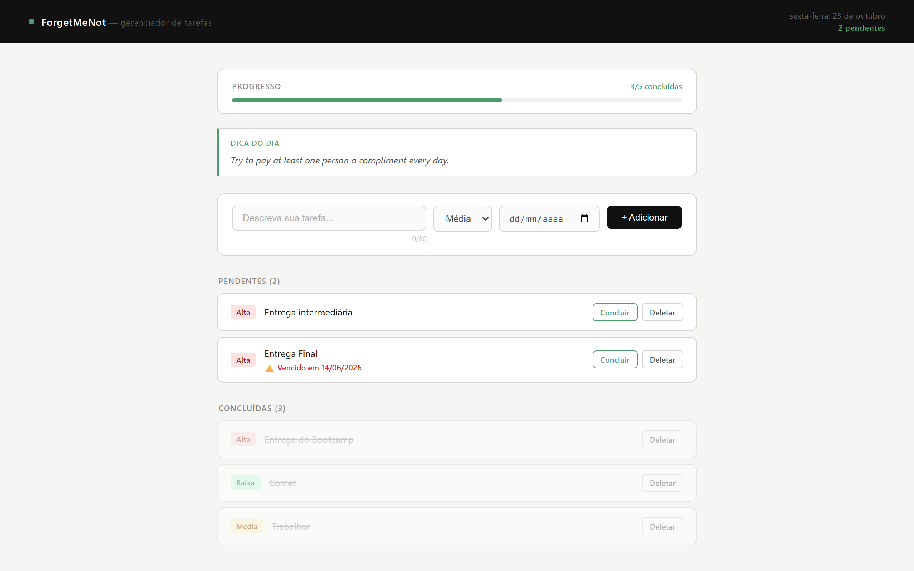

# 🦧🐦‍🔥 ForgetMeNot — Gerenciador de Tarefas

## 🌐 Aplicação publicada
**Acesse em:** [https://forget-me-not-z9hy.onrender.com](https://forget-me-not-z9hy.onrender.com) (no plano gratuito do Render, o primeiro acesso pode levar uns 40 segundos)



---

## 📝 Introdução
O **ForgetMeNot** é um gerenciador de tarefas (To-Do List) desenvolvido em Python, criado como parte de um trabalho acadêmico para demonstrar conceitos de programação, persistência de dados, integração com APIs públicas, testes automatizados, deploy em nuvem e integração contínua (CI/CD).

O projeto evoluiu de uma aplicação CLI com interface no terminal para uma **aplicação web completa**, acessível pelo navegador, com integração a uma API pública externa e publicação em serviço de nuvem.

---

## 👤 Autor
- **Isaac Gomes**
- **Repositório:** [https://github.com/IsaacGomes260653/forget_me_not](https://github.com/IsaacGomes260653/forget_me_not)
- **Aplicação publicada:** [https://forget-me-not-z9hy.onrender.com](https://forget-me-not-z9hy.onrender.com)

---

## ✨ Funcionalidades

### Interface Web (versão atual)
- **Adicionar Tarefas:** Cadastro com descrição, nível de urgência (Alta, Média, Baixa) e prazo de entrega.
- **Visualização por seções:** Tarefas separadas em *Pendentes* e *Concluídas*.
- **Barra de progresso:** Acompanhamento visual do percentual de tarefas concluídas.
- **Dica do dia:** Integração com a [Advice Slip API](https://api.adviceslip.com) — exibe uma dica motivacional a cada acesso.
- **Indicador de prazo:** Prazos são coloridos automaticamente (verde = no prazo, laranja = hoje, vermelho = vencido).
- **Confirmação de exclusão:** Modal de confirmação antes de deletar uma tarefa.
- **Conclusão de Tarefas:** Marcação de itens como concluídos com atualização imediata.
- **Persistência de Dados:** Tarefas salvas automaticamente em `tasks.json`.

### Interface CLI (versão original)
- Listagem de tarefas com tabela colorida via biblioteca `rich`.
- Adição, conclusão e exclusão de tarefas pelo terminal.

---

## 🛠️ Tecnologias Utilizadas

| Tecnologia | Uso |
|---|---|
| Python 3.11+ | Linguagem principal |
| Flask | Framework web |
| Jinja2 | Templating HTML |
| Requests | Consumo da API pública |
| Rich | Interface CLI (versão original) |
| Pytest | Testes unitários e de integração |
| Flake8 | Linting e padronização de código |
| Gunicorn | Servidor WSGI para produção |
| GitHub Actions | CI/CD automatizado |
| Render | Hospedagem em nuvem |

---

## 🔌 Integração com API Pública

O projeto consome a **Advice Slip API** — uma API pública, gratuita e sem necessidade de chave de autenticação.

- **Endpoint:** `GET https://api.adviceslip.com/advice`
- **Uso:** A cada acesso à aplicação web, uma dica aleatória é buscada e exibida na interface.
- **Fallback:** Caso a API esteja indisponível, uma mensagem padrão é exibida sem quebrar a aplicação.

---

## ⚠️ Pré-requisitos

Você precisa ter o **Python 3.x** instalado. Caso não tenha:

**🪟 Windows:**
1. Acesse [python.org/downloads](https://www.python.org/downloads/)
2. Baixe e execute o instalador.
3. **IMPORTANTE:** Marque **"Add python.exe to PATH"** antes de instalar.

**🍎 macOS:**
1. Acesse [python.org/downloads](https://www.python.org/downloads/) e baixe o instalador.
2. *(Alternativa via Homebrew: `brew install python`)*

**🐧 Linux (Ubuntu/Debian):**
```bash
sudo apt update
sudo apt install python3 python3-pip
```

---

## 🚀 Como instalar e executar

### 1. Clonar o repositório
```bash
git clone https://github.com/IsaacGomes260653/forget_me_not.git
cd forget_me_not
```

### 2. Instalar as dependências
```bash
pip install -r requirements.txt
```

### 3. Executar a aplicação web
```bash
python src/app.py
```
Acesse `http://127.0.0.1:5000` no navegador.

### 4. Executar a aplicação CLI (versão original)
```bash
python src/main.py
```

---

## 🧪 Testes

O projeto possui **testes unitários** e **testes de integração** com a API externa, executados automaticamente via GitHub Actions a cada push.

### Rodar os testes localmente
```bash
python -m pytest tests/ -v
```

### Testes implementados

| Teste | Tipo | Descrição |
|---|---|---|
| `test_salvar_e_carregar_tarefas` | Unitário | Valida persistência em JSON |
| `test_adicionar_tarefa_logica` | Unitário | Valida lógica de adição |
| `test_concluir_tarefa_logica` | Unitário | Valida conclusão de tarefa |
| `test_api_advice_retorna_status_200` | Integração | Verifica que a API responde com sucesso |
| `test_api_advice_retorna_json_valido` | Integração | Verifica estrutura do JSON retornado |
| `test_buscar_dica_mock` | Integração (mock) | Valida processamento da resposta da API |
| `test_buscar_dica_fallback_quando_api_falha` | Integração (mock) | Valida comportamento quando a API falha |

---

## 🔄 CI/CD — GitHub Actions

A cada `push` ou `pull request`, o pipeline executa automaticamente:
1. **Flake8** — verificação de padrões e qualidade do código
2. **Pytest** — execução de todos os testes unitários e de integração

---

## 📁 Estrutura do Projeto

```
forget_me_not/
├── .github/
│   └── workflows/
│       └── ci.yml          # Pipeline CI/CD
├── src/
│   ├── app.py              # Servidor Flask (interface web)
│   └── main.py             # Aplicação CLI original
├── templates/
│   └── index.html          # Interface web (HTML + CSS)
├── tests/
│   └── test_main.py        # Testes unitários e de integração
├── tasks.json              # Persistência de dados
├── requirements.txt        # Dependências do projeto
├── Procfile                # Configuração para deploy no Render
├── LICENSE                 # Licença MIT
└── README.md
```

---

## 📄 Licença

[MIT](LICENSE)

---

# 🦧🐦‍🔥 ForgetMeNot — Task Manager (English)

## 🌐 Live app
**Live at:** [https://forget-me-not-z9hy.onrender.com](https://forget-me-not-z9hy.onrender.com)

## 📝 Introduction
**ForgetMeNot** is a To-Do List app built in Python as an academic project to demonstrate core programming concepts, data persistence, public API integration, automated testing, cloud deployment, and CI/CD.

It evolved from a terminal CLI app into a **full web application**, integrating an external public API and deployed to the cloud.

## ✨ Features

**Web UI (current):** add tasks with description, urgency (High/Medium/Low), and due date; tasks split into *Pending* and *Completed* sections; a progress bar tracking completion percentage; a "tip of the day" via the [Advice Slip API](https://api.adviceslip.com); color-coded deadlines (green = on time, orange = due today, red = overdue); delete confirmation modal; instant task completion; and automatic persistence to `tasks.json`.

**CLI (original version):** colored task table via `rich`, with add/complete/delete from the terminal.

## 🛠️ Tech stack

Python 3.11+, Flask, Jinja2, Requests, Rich (CLI), Pytest, Flake8, Gunicorn, GitHub Actions (CI/CD), Render (hosting).

## 🔌 Public API integration

Consumes the free, key-less **Advice Slip API** (`GET https://api.adviceslip.com/advice`) — a random tip is fetched on every visit, with a fallback message if the API is unavailable.

## 🚀 Install & run

```bash
git clone https://github.com/IsaacGomes260653/forget_me_not.git
cd forget_me_not
pip install -r requirements.txt
python src/app.py      # web app -> http://127.0.0.1:5000
python src/main.py     # original CLI version
```

## 🧪 Tests

Unit and integration tests run automatically via GitHub Actions on every push.

```bash
python -m pytest tests/ -v
```

## 🔄 CI/CD

Every push/PR runs Flake8 (lint) then Pytest (unit + integration tests) via GitHub Actions.

## 📄 License

[MIT](LICENSE)