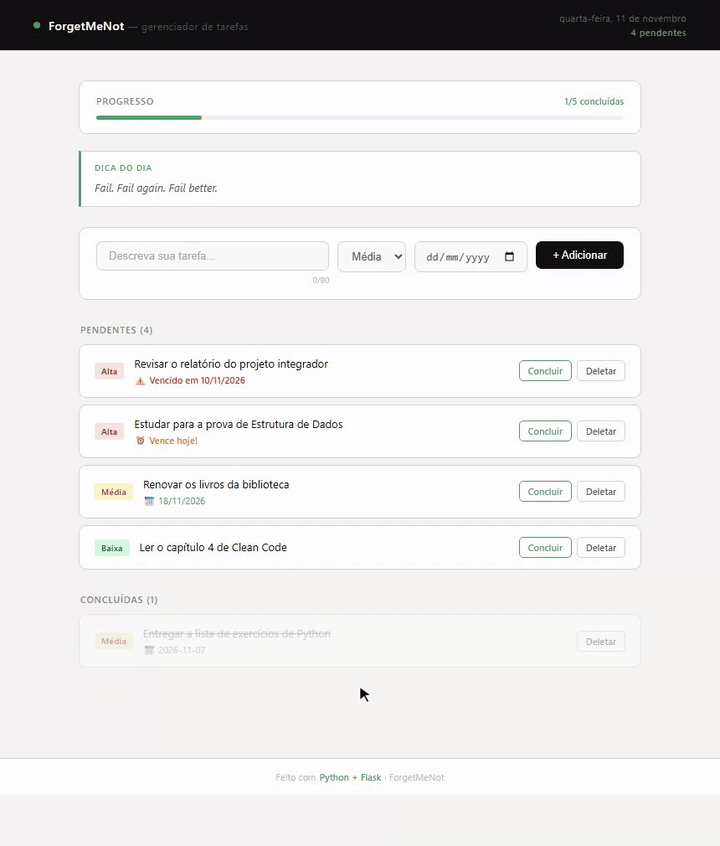

  <picture>
    <source media="(max-width: 767px)" srcset="https://raw.githubusercontent.com/IsaacGomes260653/forget_me_not/main/.github/banner-mobile.svg">
    
  </picture>

  <b>Lista de tarefas em Python e Flask em que cada tarefa tem urgência e prazo, e a página avisa o que já venceu e o que vence hoje.</b> 
  Para quem quer anotar tarefas sem criar conta, e para quem estuda Flask e quer ver um app pequeno com testes, CI e deploy. 
  <a href="https://forget-me-not-z9hy.onrender.com"><b>Abrir a demonstração</b></a> · no plano gratuito do Render, o primeiro acesso leva cerca de 30 segundos

  
  
  
  

  <a href="#demonstração">Demonstração</a> ·
  <a href="#como-rodar-em-60-segundos">Como rodar</a> ·
  <a href="#o-que-ele-faz">O que ele faz</a> ·
  <a href="#como-foi-feito">Como foi feito</a> ·
  <a href="#testes-e-qualidade">Testes e CI</a> ·
  <a href="#próximos-passos">Próximos passos</a> ·
  <a href="#english-summary">English</a>

## Demonstração

  

Gravado com o Playwright, com o app rodando localmente (`python src/app.py`) e tarefas de exemplo. A dica do dia vem da Advice Slip API na hora, por isso muda a cada recarga. O app tem só o tema claro.

