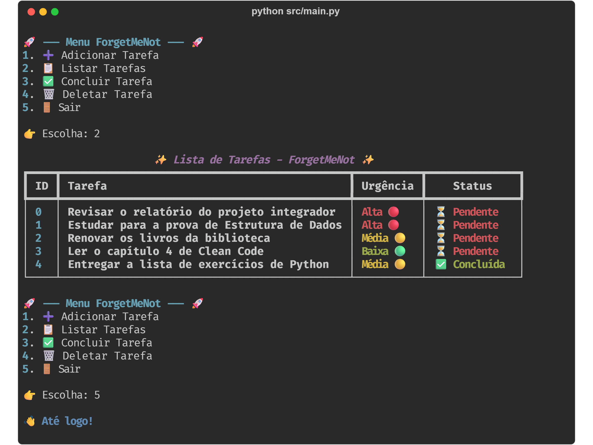
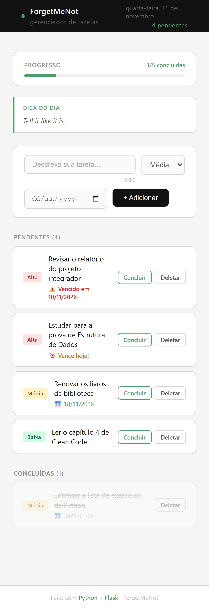
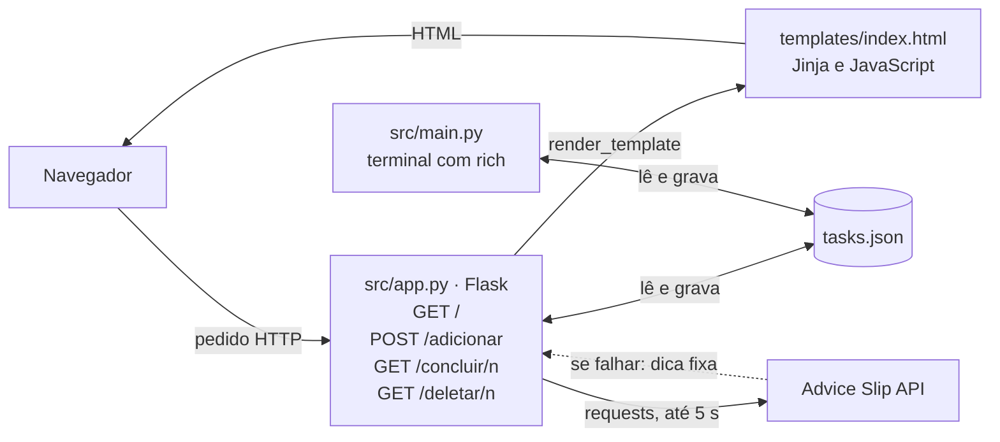

<p align="center">
  <picture>
    <source media="(max-width: 767px)" srcset="https://raw.githubusercontent.com/IsaacGomes260653/forget_me_not/main/.github/banner-mobile.svg">
    
  </picture>
</p>

<p align="center">
  <b>Lista de tarefas em Python e Flask em que cada tarefa tem urgência e prazo, e a página avisa o que já venceu e o que vence hoje.</b><br>
  Para quem quer anotar tarefas sem criar conta, e para quem estuda Flask e quer ver um app pequeno com testes, CI e deploy.<br>
  <a href="https://forget-me-not-z9hy.onrender.com"><b>Abrir a demonstração</b></a> · a lista é a mesma para todos os visitantes, e o primeiro acesso leva cerca de 30 segundos (plano gratuito do Render)
</p>

<p align="center">
  <a href="https://github.com/IsaacGomes260653/forget_me_not/actions/workflows/ci.yml"></a>
  <a href="LICENSE"></a>
  <a href="https://github.com/IsaacGomes260653/forget_me_not/commits/main"></a>
  
</p>

<p align="center">
  <a href="#demonstração">Demonstração</a> ·
  <a href="#como-rodar-em-60-segundos">Como rodar</a> ·
  <a href="#o-que-ele-faz">O que ele faz</a> ·
  <a href="#como-foi-feito">Como foi feito</a> ·
  <a href="#testes-e-qualidade">Testes e qualidade</a> ·
  <a href="#próximos-passos">Próximos passos</a> ·
  <a href="#english-summary">English</a>
</p>

## Demonstração

<p align="center">
  
</p>

Gravado com o Playwright, com o app rodando localmente (`python src/app.py`) e tarefas de exemplo. A dica do dia vem da Advice Slip API na hora, por isso muda a cada recarga. O app tem só o tema claro.

## Como rodar em 60 segundos

Precisa do Git e do Python 3.11 ou mais novo.

```bash
git clone https://github.com/IsaacGomes260653/forget_me_not.git
cd forget_me_not
python -m venv .venv
source .venv/bin/activate
pip install -r requirements.txt
python src/app.py
```

Abra <http://127.0.0.1:5000>. Num clone limpo, do `git clone` até o app no ar, levou cerca de 30 segundos (Windows 11 e Python 3.12). A CI instala as mesmas dependências no Ubuntu, com Python 3.11.

- Para a versão de terminal, rode `python src/main.py`. As duas versões leem e gravam o mesmo `tasks.json`.
- Rode os comandos na raiz do projeto: o `tasks.json` é procurado na pasta em que você está. O do repositório já vem com cinco tarefas de exemplo.
- No Windows (PowerShell), ative o ambiente com `.venv\Scripts\Activate.ps1` no lugar do `source`. Se o PowerShell bloquear o script, rode antes `Set-ExecutionPolicy -Scope Process Bypass`, que vale só para aquela janela.

## O que ele faz

Na web (`src/app.py`):

- **Tarefa com urgência e prazo.** Descrição de até 80 caracteres (o contador fica laranja depois de 60), urgência Alta, Média ou Baixa e prazo opcional.
- **Prazo que avisa.** Uma pendente com prazo aparece em vermelho quando venceu ("Vencido em 10/11/2026"), em laranja no dia ("Vence hoje!") e em verde quando ainda há tempo.
- **Pendentes e concluídas separadas**, cada seção com a sua contagem. O cabeçalho mostra a data de hoje e quantas tarefas faltam.
- **Barra de progresso** com "X/Y concluídas" e um aviso quando todas estão feitas.
- **Apagar pede confirmação** numa janela que fecha com Cancelar ou com um clique fora dela.
- **Dica do dia** da [Advice Slip API](https://api.adviceslip.com), em inglês, buscada a cada carregamento da página.
- **Tudo salvo em `tasks.json`**, sem banco de dados.

No terminal (`src/main.py`): um menu com cinco opções (adicionar, listar, concluir, deletar e sair) e a lista numa tabela colorida, feita com o rich. No terminal a tarefa não tem prazo.

<p align="center">
  
</p>

No celular, o formulário quebra em duas linhas e as tarefas ocupam a largura toda:

<p align="center">
  
</p>

## Como foi feito

| Escolha | Por quê |
|---|---|
| Python e Flask | A página e as quatro rotas cabem em um arquivo de 73 linhas, sem estrutura obrigatória de projeto. |
| Jinja (`templates/index.html`) | Contagens, barra de progresso e seções já saem prontas do servidor. O JavaScript cuida só do que depende do navegador: a data, a cor do prazo, o contador de caracteres e a janela de confirmação. |
| Arquivo JSON | Dá para abrir e ler, e serve à web e ao terminal ao mesmo tempo. Para o tamanho do projeto, não precisava de banco. |
| Requests | Faz o pedido da dica do dia à Advice Slip API. |
| rich | Tabela colorida e emojis no terminal, sem escrever códigos de cor na mão. |
| Pytest e `unittest.mock` | Testam a persistência e a dica, com a API de verdade e com a API simulada. |
| Flake8 | Padroniza o código. A CI falha se ele reclamar. |
| GitHub Actions | Roda o lint e os testes em cada push e pull request para a `main`. |
| Gunicorn e Render | O servidor do Flask é só para desenvolvimento. No Render, o app sobe com `gunicorn src.app:app`, do `Procfile`. |



Cada ação (adicionar, concluir ou apagar) carrega o `tasks.json`, muda a lista, grava o arquivo e redireciona para `/`, que monta a página de novo com a lista atualizada e busca outra dica.

### Decisões técnicas e o que eu aprendi

- **API externa com plano B.** O `buscar_dica()` espera no máximo 5 segundos e, se qualquer coisa der errado, devolve "Foque no que importa: uma tarefa de cada vez." A página nunca quebra por causa da dica, e dois testes com mock cobrem os dois caminhos.
- **Post/Redirect/Get.** Toda ação termina num redirecionamento para `/`. Por isso, recarregar a página depois de adicionar uma tarefa não cria a mesma tarefa de novo.
- **A posição na lista como identificador.** As tarefas não têm id: concluir e apagar usam a posição delas no `tasks.json`. O template percorre a lista inteira, e não uma lista filtrada, para que `loop.index0` continue apontando para a posição certa mesmo com as tarefas divididas em duas seções. Funciona, mas tem limites (veja os próximos passos).
- **O servidor calcula, o navegador cuida do relógio.** As contagens vêm do Jinja; a cor do prazo é calculada no navegador, com a data de quem está olhando. Ao revisar este README, descobri um bug nessa parte: a data de hoje sai do `toISOString()`, que está em UTC, e depois das 21h em Brasília uma tarefa que vence hoje aparece como vencida.
- **Servidor de desenvolvimento não é servidor de produção.** `python src/app.py` usa o servidor do Flask, com debug ligado. No Render, quem atende é o Gunicorn.
- **Teste de integração depende da internet.** Dois testes chamam a Advice Slip API de verdade: provam que a integração funciona, mas derrubam a CI se a API sair do ar. Os testes com mock cobrem a mesma função sem rede.

<details>
<summary>Estrutura de pastas</summary>

```
.
├── src/
│   ├── app.py            # app web: as rotas do Flask e a dica do dia
│   └── main.py           # versão de terminal: menu e tabela do rich
├── templates/
│   └── index.html        # a página: Jinja, CSS e o JavaScript dos prazos e da confirmação
├── tests/
│   └── test_main.py      # 7 testes: persistência, lógica e a Advice Slip API
├── tasks.json            # as tarefas (vem com cinco de exemplo)
├── requirements.txt      # dependências com versão fixa
├── Procfile              # comando do Render: gunicorn src.app:app
├── VERSION               # 1.0.0
├── .gitattributes        # tira o HTML da contagem de linguagens do GitHub
└── .github/
    ├── workflows/ci.yml  # CI: flake8 e pytest
    └── capturas/         # GIF e capturas deste README
```

</details>

## Testes e qualidade

```bash
python -m pytest tests/ -v
flake8 src/ --max-line-length=200
```

Sem internet, os dois testes que chamam a Advice Slip API de verdade falham. Para rodar só os outros cinco: `python -m pytest tests/ -v -k "not api_advice"`.

São 7 testes, e os 7 passaram no clone limpo. Os testes usam um `test_tasks.json`, criado e apagado a cada teste, então o seu `tasks.json` não é tocado.

<details>
<summary>O que cada teste verifica</summary>

| Teste | Tipo | O que verifica |
|---|---|---|
| `test_salvar_e_carregar_tarefas` | unidade | Grava uma tarefa com `salvar_tarefas` e lê de volta com `carregar_tarefas`, do `src/main.py`. |
| `test_adicionar_tarefa_logica` | unidade | Acrescenta uma tarefa numa lista, sem chamar o código do app. |
| `test_concluir_tarefa_logica` | unidade | Marca uma tarefa de uma lista como concluída, sem chamar o código do app. |
| `test_api_advice_retorna_status_200` | integração (internet) | A Advice Slip API responde com status 200. |
| `test_api_advice_retorna_json_valido` | integração (internet) | A resposta tem `slip.advice` com um texto não vazio. |
| `test_buscar_dica_mock` | mock | Com o `requests.get` simulado, `buscar_dica()` devolve o texto da resposta. |
| `test_buscar_dica_fallback_quando_api_falha` | mock | Com o `requests.get` dando erro, `buscar_dica()` devolve a dica fixa. |

</details>

O workflow [`ci.yml`](.github/workflows/ci.yml) roda em cada push e pull request para a `main`, no Ubuntu com Python 3.11: instala as dependências, roda o Flake8 em `src/` (com linhas de até 200 caracteres) e depois o Pytest.

## Próximos passos

- [ ] Corrigir a cor do prazo depois das 21h em Brasília, comparando com a data local em vez da data em UTC.
- [ ] Dar um id fixo a cada tarefa e trocar `GET /concluir` e `GET /deletar` por POST, para que uma aba desatualizada não conclua nem apague a tarefa errada.
- [ ] Trocar o `tasks.json` por um banco: na demonstração, todos os visitantes dividem a mesma lista, e o disco do Render não guarda os arquivos quando o serviço reinicia ou é publicado de novo.
- [ ] Testar as rotas com o `app.test_client()` do Flask e fazer os testes de lógica chamarem o código do app.
- [ ] Mostrar o prazo das tarefas concluídas como dd/mm/aaaa (hoje aparece 2026-11-07).

## Autor

Isaac Gomes de Moraes · [LinkedIn](https://www.linkedin.com/in/isaacgomesmoraes/) · [e-mail](mailto:isaacgm260653@gmail.com) · [GitHub](https://github.com/IsaacGomes260653)

## Licença

O código está sob a licença [MIT](LICENSE). A dica do dia vem da [Advice Slip API](https://api.adviceslip.com).

---

## English summary

**ForgetMeNot** is a to-do list built with Python and Flask as an academic project. Each task has an urgency level and an optional due date, and the page flags what is overdue and what is due today. **[Live demo](https://forget-me-not-z9hy.onrender.com)** (Render free tier, so the first request takes about 30 seconds).

- **Web app:** add tasks with urgency and due date, separate pending and done lists, a progress bar, delete confirmation and a tip of the day from the [Advice Slip API](https://api.adviceslip.com), with a fixed fallback if the API takes longer than 5 seconds or fails.
- **Terminal app:** a menu and a colored task table built with rich, sharing the same `tasks.json`.
- **Quality:** 7 Pytest tests (persistence, the real API and mocked API calls) and Flake8, both run by GitHub Actions on every push and pull request to `main`. Production runs on Gunicorn, on Render.

**Run it:** `git clone https://github.com/IsaacGomes260653/forget_me_not.git`, create a virtual environment, `pip install -r requirements.txt` and `python src/app.py`, then open <http://127.0.0.1:5000>. Code under the [MIT](LICENSE) license.
